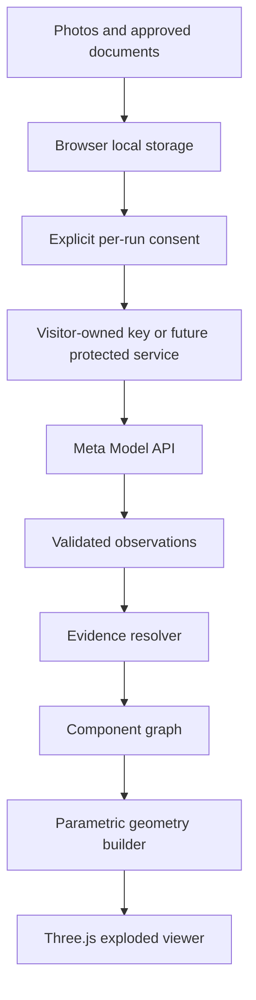

# Architecture v1.0

## Current implementation

One statically exported Next.js TypeScript application, local-first browser state, deterministic domain reconstruction and a React Three Fiber viewer. The current artifact has no server routes. Its optional BYOK adapter can test a visitor-owned key and, after explicit per-action consent, submit exactly three local photos directly to Meta Model API.

## Boundaries

- `src/domain`: no React, Next.js, Three.js, or Meta dependencies.
- `src/server`: reserved for a future protected provider adapter; absent from the static build.
- `src/features`: UI composition and user interaction.
- `src/storage`: browser persistence; never import in server routes.
- `src/shared`: small generic types only.

## MVP source of truth

The versioned project graph and its evidence records, not the model's narrative and not the Three.js mesh.

## Implemented inference boundary

- `src/features/inference/meta-model-api.ts` owns Meta request/response handling and maps provider failures to stable sanitized codes.
- `src/domain/inference/observation.ts` validates the structured response before domain processing.
- `src/domain/evidence/resolve-photo-observations.ts` is a pure deterministic resolver with no browser, React, Three.js or Meta dependency.
- `src/domain/reconstruction/evidence-geometry.ts` creates an estimated primitive only for an observed, source-linked, recognized external category; every other shape is a placeholder.
- IndexedDB schema version 2 stores run metadata, consent, exact photo IDs, validated observations and the resolved project. It never stores the API key or raw request images inside a run.

## Geometry rules

- Use millimeters in domain; convert to scene units in viewer.
- Presence, dimensions, position and shape are separate claims.
- No evidence means `inferred` or `unknown`, never `observed` or `documented`.
- Render unsupported internals as transparent placeholders.
- Store exploded offsets separately from physical part positions.

## Viewer experience

- The WebGL canvas is the dominant inspection surface; all menus, evidence details and controls remain accessible HTML.
- A lightweight presentation route is rendered before the WebGL workbench so the GPU-heavy scene is mounted only after an explicit user action.
- `GlassPanel` provides an opaque fallback and enables a restrained backdrop blur only when supported.
- Desktop uses an optional component list and a side inspector. Both start closed. Mobile uses a compact action bar and a bottom-sheet inspector with safe-area spacing.
- Reduced graphics mode forces DPR 1, disables canvas shadows/contact shadows and removes backdrop blur.
- Evidence status is always expressed with text and a symbol; the terracotta accent indicates interaction, never factual certainty.
- The viewer exposes three presentation transforms: workbench, exploded, and assembled. These transforms do not alter the project graph or claim physical truth.
- Camera navigation supports pointer, touch, and keyboard input. WASD/arrow keys pan, Q/E orbit, +/- zoom, and 0 restores the saved camera pose. Keyboard shortcuts ignore focused form controls and buttons.
- Workbench dragging modifies only temporary scene offsets. The tidy-up action restores deterministic slots, while reconstruction interpolates each part toward its assembly transform with a staggered delay.

## Local-first privacy

Original photos stay in browser IndexedDB. A BYOK key stays in memory by default or in session storage by explicit choice. For each Meta photo analysis, the user explicitly approves sending three images. Data necessarily leaves the device during that call. EIDA has no server persistence in MVP.

## Deployment

The current `out/` artifact is static and may be served without a backend. HTTPS remains required for reliable mobile camera access outside localhost. Browser storage is per-origin and may be evicted.

## Future protected-service contracts

- `POST /api/analyze`: approved resized images -> validated observations.
- `POST /api/segment`: image and noun phrase -> masks/boxes.
- `POST /api/documents/extract`: approved document -> referenced claims.

## Error handling

Use stable error codes, timeouts, no raw provider messages in storage, and at most one retry for `429` or `5xx`. There is no silent fallback from a failed live call to a successful mock result.
