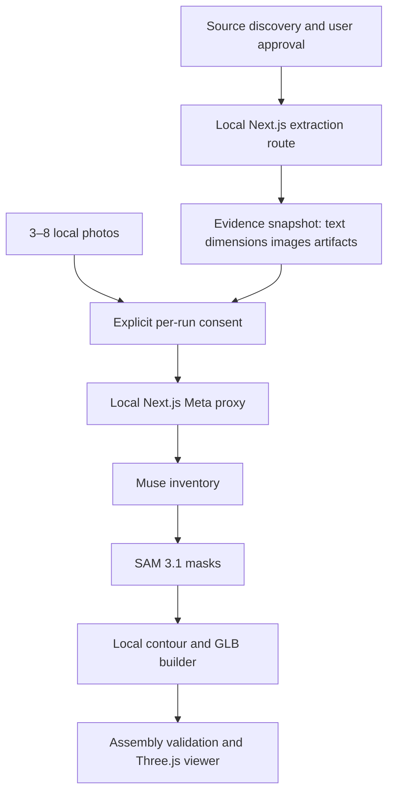

# Architecture v1.1

## Current implementation

One Next.js TypeScript application, local-first browser state, a small server-side provider/source proxy, deterministic domain reconstruction and a React Three Fiber viewer. The static GitHub Pages showcase is a separate target: it can present documentation and fixture assets but cannot run the live reconstruction path.

## Boundaries

- `src/domain`: no React, Next.js, Three.js, or Meta dependencies.
- `src/server`: public-URL safety checks, evidence extraction and the local Meta proxy. It is not a complete multi-user backend.
- `src/features`: UI composition and user interaction.
- `src/storage`: browser persistence; never import in server routes.
- `src/shared`: small generic types only.

## MVP source of truth

The versioned project graph and its evidence records, not the model's narrative and not the Three.js mesh.

## Implemented reconstruction boundary

- `src/server/research/web-evidence.ts` fetches only approved public HTTPS sources, bounds response size, blocks private-network targets and extracts relevant HTML evidence.
- `src/app/api/meta/inventory` validates Muse's strict inventory response; `src/app/api/meta/segment` decodes SAM's streamed masks with the official parser.
- `src/features/local-reconstruction` turns accepted masks into simplified, estimated GLB silhouettes and validates their assembly locally.
- IndexedDB stores projects and photo blobs locally. Provider keys, raw provider responses and extracted source bodies are not persisted as inference records.

## Geometry rules

- Use millimeters in domain; convert to scene units in viewer.
- Presence, dimensions, position and shape are separate claims.
- No evidence means `inferred` or `unknown`, never `observed` or `documented`.
- Render unsupported internals as transparent placeholders.
- Store exploded offsets separately from physical part positions.

## Viewer experience

- The WebGL canvas is the dominant inspection surface; all menus, evidence details and controls remain accessible HTML.
- A lightweight presentation route is rendered before the WebGL workbench so the GPU-heavy scene is mounted only after an explicit user action.
- `GlassPanel` provides an opaque fallback and enables a restrained backdrop blur only when supported.
- Desktop uses an optional component list and a side inspector. Both start closed. Mobile uses a compact action bar and a bottom-sheet inspector with safe-area spacing.
- Reduced graphics mode forces DPR 1, disables canvas shadows/contact shadows and removes backdrop blur.
- Evidence status is always expressed with text and a symbol; the terracotta accent indicates interaction, never factual certainty.
- The viewer exposes three presentation transforms: workbench, exploded, and assembled. These transforms do not alter the project graph or claim physical truth.
- Camera navigation supports pointer, touch, and keyboard input. WASD/arrow keys pan, Q/E orbit, +/- zoom, and 0 restores the saved camera pose. Keyboard shortcuts ignore focused form controls and buttons.
- Workbench dragging modifies only temporary scene offsets. The tidy-up action restores deterministic slots, while reconstruction interpolates each part toward its assembly transform with a staggered delay.

## Local-first privacy

Original photos stay in browser IndexedDB. A BYOK key stays in memory by default or in session storage by explicit choice. For each reconstruction launch, the user explicitly approves sending the selected photos and approved evidence context. Data necessarily leaves the device during extraction/Meta calls. EIDA has no durable server database in this local path.

## Deployment

`npm run dev` or `npm run build && npm start` serves the live path. HTTPS remains required for reliable mobile camera access outside localhost. Browser storage is per-origin and may be evicted. GitHub Pages can host only a separate static guide/demo; it cannot safely host the provider proxy or secret.

## Future protected-service contracts

- `POST /api/analyze`: approved resized images -> validated observations.
- `POST /api/segment`: image and noun phrase -> masks/boxes.
- `POST /api/documents/extract`: approved document -> referenced claims.

## Resource limits and non-goals

The implementation intentionally avoids paid infrastructure: no hosted GPU, search API, database, object storage, queue or server-side billing is part of the current path. That means source extraction is bounded, PDF/CAD contents are only indexed, live processing is sequential and local, provider credits are user/hackathon supplied, and there is no public-user isolation or quota enforcement. Full photogrammetry, hidden-surface CAD, material identification and certified repair/recycling guidance are outside the current evidence model.

## Error handling

Use stable error codes, timeouts, no raw provider messages in storage, and at most one retry for `429` or `5xx`. There is no silent fallback from a failed live call to a successful mock result.
